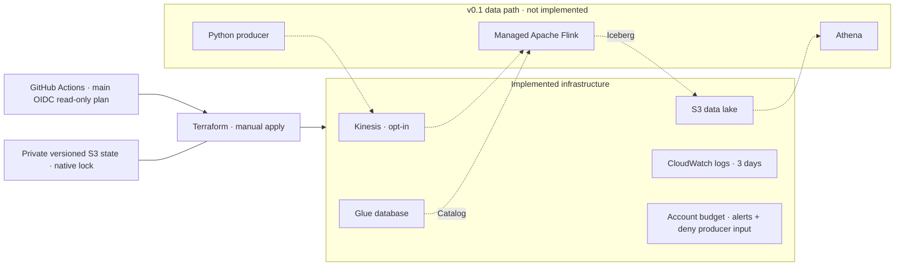

# AWS Clickstream Platform

A reproducible AWS portfolio project for application distribution and ad attribution events: `impression → click → install → activation/payment`.

**Status:** v0.0.1 infrastructure source is implemented. Cloud deployment, live CI and release acceptance are pending. There is no running producer, Flink job or Iceberg table yet. See [acceptance](docs/acceptance.md) for evidence, and [PROJECT.md](PROJECT.md) for the full staged scope.



[Detailed architecture](docs/architecture.md) distinguishes provisioned resources from future data paths.

## Quick start

Prerequisites: Terraform >=1.10 (CI uses 1.13.5), AWS CLI v2, Git, an AWS account with a locally authenticated operator role, and a GitHub repository. Use short-lived local credentials/SSO; never put credentials in tfvars or GitHub secrets.

```bash
cp infra/bootstrap/terraform.tfvars.example infra/bootstrap/terraform.tfvars
cp infra/terraform.tfvars.example infra/terraform.tfvars
cp infra/backend.tfbackend.example infra/backend.tfbackend
# Edit both tfvars: owner, region, exact GitHub main OIDC sub, operator role, email.
aws sts get-caller-identity
make check
make bootstrap-init bootstrap-plan
make bootstrap-apply
terraform -chdir=infra/bootstrap output
# Put state_bucket output into infra/backend.tfbackend.
make init
make plan
# Review every change before applying the saved plan.
make apply
# For acceptance: set enable_stream=true, repeat plan/apply, capture evidence.
make destroy
```

Bootstrap uses local state; back up `infra/bootstrap/terraform.tfstate` securely. Never commit it. The demo stack uses encrypted, versioned remote state with S3 native locking. `make destroy` preserves bootstrap resources. A nonempty lake intentionally blocks destroy; `make nuke` explicitly confirms and empties only that lake before destroying the demo stack.

[Deployment runbook](docs/runbook.md) covers GitHub settings, cost controls, teardown and the acceptance sequence.

## Engineering decisions

- **Kinesis over MSK:** the small, intermittent demo prioritizes managed ingestion without operating a Kafka cluster. Kinesis on-demand still incurs provisioned service costs while idle; enable only for a timed demo. PROJECT.md's hourly comparisons are estimates, not current quotes. Check [Kinesis pricing](https://aws.amazon.com/kinesis/data-streams/pricing/) and [MSK pricing](https://aws.amazon.com/msk/pricing/) for the selected region/mode before deployment.
- **Iceberg from the first working pipeline:** v0.1 will implement checkpoint-aware Flink writes with Glue catalog and Athena reconciliation. A bare S3 bucket is not an Iceberg table.
- **Main-only cloud plans:** ordinary PR OIDC tokens carry a `pull_request` subject, whereas the role trusts an exact main-branch subject. PRs run scan/fmt/validate/mock tests offline; push to main or manual dispatch on main generates the cloud plan. No automatic apply.
- **Read-only CI:** IAM reads are scoped to project resources where supported; the only CI writes are the S3 lock object. Apply/destroy use your local operator identity. CI access must be expanded deliberately for later phases.
- **Budget Action limits input:** 50/80/100% account-wide actual-cost alerts; at 100% the Budgets role attaches a deny-input policy to the producer role. This is neither a hard dollar cap nor automatic shutdown: bills lag, alternate identities are unaffected, and running services keep charging. Destroy after every session.

## Security and cost boundaries

Private encrypted data/state buckets deny insecure transport. State has versioning and no automatic deletion. OIDC trusts the exact repository/main subject and AWS STS audience; new GitHub repositories may include immutable IDs. Secret scanning covers history in CI. Local configuration and state are ignored. Never upload binary plan/state files; readable plan artifacts still contain metadata (including email) and expire after three days.

Lake prefixes `raw/` and `curated/` expire after seven days; logs after three. **Before Iceberg is enabled, replace generic curated expiration with Iceberg-aware snapshot/file maintenance** so active tables are not corrupted. The budget is account-wide and can trigger from other projects; use a dedicated demo account where possible. Billing cost-allocation tags require account-side activation.

## Roadmap and release evidence

- [ ] v0.0.1 — apply/destroy proven, PR checks green, main OIDC plan proven, scan clean, no tracked state, public skeleton release.
- [ ] v0.1 — producer → Kinesis → Flink → Iceberg → Athena; manifest reconciliation, demo and cost evidence.
- [ ] v0.2 — duplicate/late/out-of-order/schema fixtures, DLQ, checkpoint recovery and measured latency/throughput.
- [ ] v1.0 — Snowflake + local Airflow + dbt, idempotent loads, SCD2, backfill, RBAC and cost attribution.

Do not claim cloud deployment or end-to-end correctness on a resume until that phase's evidence exists. Each accepted phase includes an architecture diagram, three-minute demo, release and a LinkedIn draft. Snowflake trial starts only immediately before v1.0 work.
