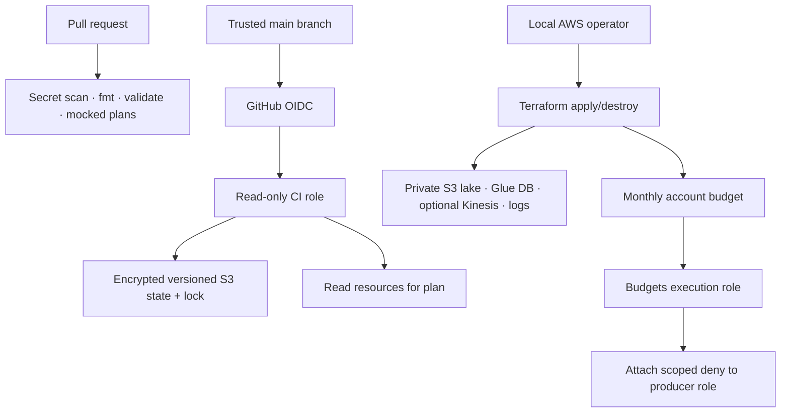
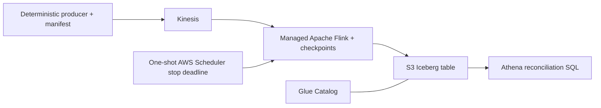

# Architecture and boundaries

## Control plane

Bootstrap owns the state bucket and CI identity; demo state owns resources to destroy after each session. No bootstrap removal is hidden inside a teardown command. The bootstrap state bucket has `prevent_destroy` and `force_destroy=false`.

The CI role cannot create cloud resources, write data or overwrite state; it can create/delete only the exact `.tflock` object. Some list/read APIs need Resource `*`; those exceptions appear explicitly in the policy. Trust is exact `StringEquals`, with no repo or branch wildcard. The OIDC provider can be reused when another repository has already created it in the account.

The producer role trusts one existing IAM operator role and only writes the named stream. Budgets can attach/detach only the named deny policy on that producer role. A local operator can still clean up after the action triggers.

## v0.1: verified data path

The v0.1 feature branch implements Java 11/Flink 1.20, Kinesis connector 5.0.0-1.20, Iceberg 1.10.0, checkpoint-aware GlueCatalog/S3FileIO writes, a bounded service role and Athena engine 3. AWS verification matched all 1,030 rows and business keys; see v01-acceptance.md for the exact query/snapshot and remaining cleanup status. Validate source replay and checkpoint/sink commit semantics before making an exactly-once claim.

Generic S3 expiration applies only to raw uploads and Athena results. Iceberg files have no S3 expiry. This disposable demo stops Flink before purging the table; a long-lived deployment requires Iceberg-aware snapshot expiration and conservative orphan maintenance.

## Next: v0.2 and v1.0

Reliability adds schema compatibility, deterministic fault fixtures, event-time deduplication, DLQ and recovery experiments. Analytics adds batch manifests, local Airflow, Snowflake staging, dbt models/tests/snapshots, RBAC and warehouse cost accounting. Maintain shared event/business keys across stages.

References: [S3 Terraform backend](https://developer.hashicorp.com/terraform/language/backend/s3), [GitHub OIDC subjects](https://docs.github.com/en/actions/reference/security/oidc), [AWS Budget Actions](https://docs.aws.amazon.com/cost-management/latest/userguide/budgets-controls.html).

The deadline execution role can only stop the named demo app. Its trust is constrained to the project schedule-group ARN, as required by Scheduler. The CLI verifies an enabled exact target with a UTC deadline 2–15 minutes ahead. A local timer is not the independent safeguard. Successful automatic force-stop was not exercised because normal stop completed first.

The operator reads result-bucket region metadata through a bucket resource policy scoped to its exact role ARN and the lake bucket. Its fixed boundary still applies. Dedicated demo query history is recursively removed during workgroup teardown after evidence is copied locally. Scheduler group deletion additionally authorizes DeleteSchedule on the project group wildcard; no wildcard create/update is needed.
